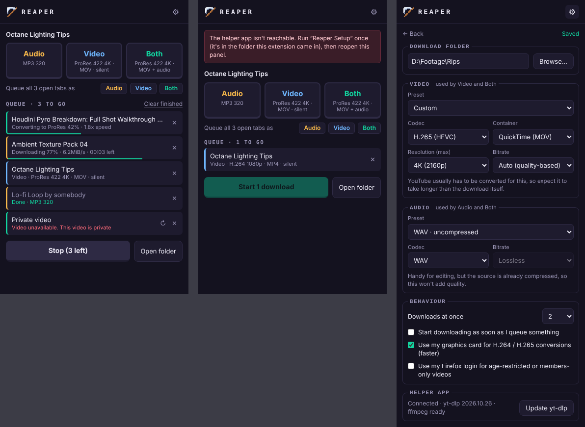

# Reaper


A Firefox extension that queues YouTube videos and SoundCloud tracks from your open tabs, then downloads them all at once as audio, video or both, in the format you choose.

- One click per tab to queue: **Audio**, **Video** or **Both**
- One click to start the whole queue
- Presets for H.264, H.265, ProRes, DNxHR, MP3, WAV, FLAC and more, or pick codec, container, resolution and bitrate yourself
- Choose your download folder; settings are remembered
- Runs several downloads at once across tabs



Reaper has two parts: the Firefox extension, and a small helper app that does the downloading and converting with [yt-dlp](https://github.com/yt-dlp/yt-dlp) and [ffmpeg](https://ffmpeg.org). A browser extension can't re-encode video or save to any folder on its own, which is why the helper is needed.

## Install

### 1. The helper app

**Windows**

1. Download [`Reaper.Setup.exe`](https://github.com/LAWSON-CROSS/reaper/releases/latest/download/Reaper.Setup.exe) and run it.
2. Windows may say "Windows protected your PC" because the file isn't code-signed. Click **More info**, then **Run anyway**.

**macOS and Linux**

Paste this into a terminal:

```sh
curl -fsSL https://raw.githubusercontent.com/LAWSON-CROSS/reaper/main/install.sh | sh
```

On macOS, ffmpeg is installed through [Homebrew](https://brew.sh); install Homebrew first if you don't have it. macOS support is new and has had little testing, so please [open an issue](https://github.com/LAWSON-CROSS/reaper/issues) if something breaks.

The helper installs into your user folder, downloads yt-dlp, ffmpeg and deno (about 250 MB, skipping any you already have) and registers itself with Firefox. It needs no administrator rights.

### 2. The extension

Install Reaper from [Firefox Add-ons](https://addons.mozilla.org/firefox/addon/reaper-ripper/), then pin the scythe to your toolbar.

## Use

1. Open a YouTube video or SoundCloud track and click the scythe.
2. Pick a type. The tab joins the queue.
   - **Audio**: audio file only
   - **Video**: picture only, no sound (file name ends in "(no audio)")
   - **Both**: one video file with sound
3. Repeat on other tabs, or use **Queue all open tabs**.
4. Click **Start**. The number on the icon is how many are left.

The cog opens settings. Each queued item keeps the format it was queued with.

## Troubleshooting

- **YouTube downloads suddenly fail:** YouTube changes often. Open settings and click **Update yt-dlp**.
- **"Reaper needs its helper app":** run the helper setup again; it repairs itself.
- **Age-restricted or members-only video:** turn on "Use my Firefox login" in settings.

## Uninstall

Remove the extension in Firefox, then run the helper setup with `--uninstall` and delete its folder (`%LOCALAPPDATA%\Reaper` on Windows, `~/.local/share/reaper` on Linux, `~/Library/Application Support/Reaper` on macOS).

## Privacy

Reaper collects nothing and contacts no servers of its own. The helper talks only to the sites you download from, and to GitHub to fetch yt-dlp, ffmpeg and deno.

## Please use it responsibly

Only download material you have the right to download: your own uploads, public-domain or openly licensed work, or content you have permission for. Downloading may be against a site's terms of service, and you are responsible for how you use this tool.

## Build from source

Needs Go 1.22+ and `zip`.

```sh
./build.sh
```

`extension/` is the Firefox extension (plain JavaScript, no build step). `host/` is the helper, written in Go with no dependencies. `tools/` holds the icon generator and tests.

## Licence

MIT. Reaper is not affiliated with YouTube, SoundCloud, or Cockos REAPER.
